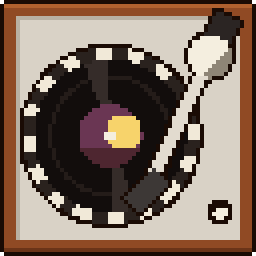
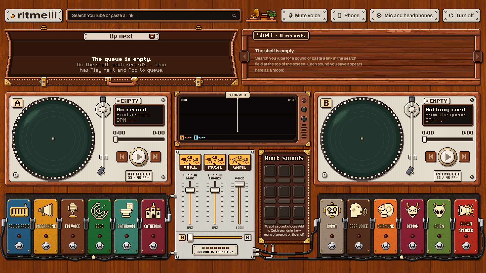

<p align="center">
  
</p>

<h1 align="center">Ritmelli</h1>

<p align="center">
  Play music and sound effects through your microphone in any game or voice call,<br>
  change your voice with live effects, and hear the music in your headphones without hearing yourself.
</p>

<p align="center">
  <a href="https://github.com/ritmelli/ritmelli-releases/releases/latest/download/Ritmelli-setup.exe"></a><br>
  <sub>Ritmelli isn't code-signed yet, so your browser and Windows will warn you about it: the <a href="#install">Install</a> section below shows what to click.</sub>
</p>

<p align="center">
  <a href="https://github.com/ritmelli/ritmelli-releases/releases/latest"></a>
  <a href="LICENSE"></a>
</p>

<p align="center">
  
</p>

Ritmelli is a free, open-source Windows app whose interface is a 1970s stereo rack drawn in pixel art. Everyone in
your game or call hears the music mixed with your voice, through the microphone they already hear you on, so your
friends don't need to install anything. It works with any game or call app that lets you choose a microphone, as long
as it runs on the same computer as Ritmelli. A game running on another device, like a console, doesn't get the music.

## Features

- **Music from YouTube:** search or paste a link. A song starts streaming right away and downloads in the background,
  so it stays on your shelf, Ritmelli's record collection.
- **Automatic transition:** when a song ends, the next one in the queue blends in. When both have a steady beat and
  close tempos, it comes in on the beat, with its tempo matched to the outgoing song and the key left untouched;
  otherwise it's a volume crossfade.
- **Play similar songs:** keeps the queue full with similar songs, ordered by tempo and marked **Auto**.
- **Automatic volume:** plays every song at a similar loudness. It's on by default; turn it off in
  **Mic and headphones**.
- **Quick sounds:** pads that play short sounds over the music. They start empty. To add a sound, search for it and
  click the **⊕** next to the result: that saves it to your shelf without playing it. If it's 15 seconds or shorter,
  it goes to the pads by itself. For a longer one, choose **Add to Quick sounds** in its **⋯** menu on the shelf; its
  pad plays only the first 2 minutes.
- **Voice effects:** police radio, megaphone, FM voice, echo, bathroom, cathedral, robot, deep voice,
  chipmunk, demon, alien and blown speaker, applied live to your voice.
- **Mute voice:** silences your voice in the game or call while the music keeps playing. To try a voice effect
  without anyone else hearing it, mute your voice and turn on **Hear my voice** on the phone remote; you hear yourself
  in your headphones.
- **Phone remote:** control Ritmelli from your phone's browser, on the same network as the computer, so you can
  change songs and play Quick sounds without leaving your game.
- **Two languages:** English and Brazilian Portuguese. The interface follows each device's list of preferred
  languages (your computer, your phone): if Portuguese (from any country) appears in it before any English, the
  device gets Brazilian Portuguese; otherwise, it gets English.

## Install

Ritmelli needs 64-bit Windows 10 or 11 on a PC with an Intel or AMD processor. On a PC with an ARM processor (such as
Snapdragon), the microphone filter can't run, so the installer stops with a message that says so. To check your PC, open
**Settings > System > About** in Windows: **System type** must say *64-bit operating system, x64-based processor*.

Install Ritmelli when you aren't in a game or call. The installer adds Ritmelli's microphone filter to every
microphone on the computer, and the computer's sound stops for a few seconds while Windows reloads them.

1. Download [**Ritmelli-setup.exe**](https://github.com/ritmelli/ritmelli-releases/releases/latest/download/Ritmelli-setup.exe),
   the installer for the latest version. The
   [release page](https://github.com/ritmelli/ritmelli-releases/releases/latest) lists what's new in it. If you
   download from there instead, either of the two files ending in `-setup.exe` works: they're the same installer. The
   other files there are for automatic updates and for developers.
   - Ritmelli isn't code-signed yet (see [Code signing policy](#code-signing-policy)), so your browser and Windows
     show warnings along the way. If your browser says the file isn't commonly downloaded, choose to keep it (in Edge,
     click **...** next to the download, then **Keep**, **Show more** and **Keep anyway**).
2. Run it. It includes everything Ritmelli needs; you don't have to install Python or anything else.
   - If Windows shows **Windows protected your PC**, click **More info**, then **Run anyway**.
   - If **Smart App Control** blocks it, there's no **Run anyway**. Smart App Control blocks unsigned apps it doesn't
     recognize, with no exceptions, so until Ritmelli is code-signed, it only installs and runs with Smart App Control
     turned off (**Windows Security > App & browser control > Smart App Control settings**). That setting covers every
     app, not just Ritmelli. On an up-to-date Windows 11 you can turn it back on there later, but Ritmelli won't run
     while it's on.
   - When Windows asks whether to allow an app from an unknown publisher to make changes to your device, choose
     **Yes**. The installer needs this permission to prepare your microphones and to let Ritmelli through the
     firewall so your phone can reach the computer.
3. On the last page of the installer, leave **Open Ritmelli** checked. Next time, open it from the Start menu.

Updates download automatically and install when Ritmelli is closed. If an update changes the microphone filter, the
computer's sound stops for a few seconds while it installs.

To remove Ritmelli, uninstall it from **Settings > Apps** in Windows. That removes the filter and puts your
microphones back the way they were. Your shelf and settings stay on the computer in case you install it again.

## Quick start

The first time you open Ritmelli, a welcome screen covers steps 1 to 4 below and offers to connect your phone.

1. **Check your microphone and headphones.** The microphone is the one you speak into; the headphones are where you
   hear the music. Use headphones, not speakers: your microphone can pick the music up from speakers, and then
   everyone hears it twice. Ritmelli follows the Windows defaults; to pick other devices, click **Mic and headphones**
   at the top.
2. **Use the same microphone in the game and the call.** In the audio settings of your game and your call app, choose
   the microphone selected in Ritmelli. The music only goes out through that one. If they have a noise suppression
   option (sometimes called noise reduction or noise cancellation), turn it off there too: it can treat the music as
   noise and cut it out. Step 3 has the exact settings for Discord.
3. **Set up Discord, if you use it.** In **User Settings > Voice & Video**, check that **Input Device** is the
   microphone from step 2, and choose **Studio** under **Input Profile**. Avoid **Voice Isolation**, whose Krisp noise
   suppression cuts the music out. If you'd rather use **Custom**, set **Noise Suppression** to **None** and turn off
   automatic input sensitivity there.
4. **Play your first song.** Type a song name or paste a YouTube link in the search field at the top, then click a
   result to play it.
5. **Set the volume.** On the mixer, **Music in game** sets how loud everyone else hears the music, and
   **Music in phones** (**Music in headphones** in a narrower window and on the phone remote) sets how loud you hear
   it in your headphones.
   **Voice** is your microphone's volume in Windows.

Keep the Ritmelli window open or minimized during your game or call. Closing it turns Ritmelli off, and your
microphone keeps working as usual, without the music.

The music only goes out while your microphone is open in the game or call. If you're muted there, or you use
push-to-talk and aren't holding the key, nobody hears it.

## Phone remote

Your phone must be connected to Wi-Fi on the same network as the computer, not to mobile data; the computer itself can
be connected to the router by cable. On the computer, click **Phone** at the top of the window to show a QR code. Point
your phone's camera at it, or open the address shown next to it in your phone's browser and type in the 6-digit code.
The phone stays paired until you disconnect it on the same screen. Other devices on the network can open the page, but
can't change anything without the code.

The connection between the phone and the computer is not encrypted (plain HTTP). Use it on your home network, not on
public Wi-Fi.

## How it works

Ritmelli installs an audio filter (an Audio Processing Object, or APO) on your microphones, inside the Windows audio
system. The filter mixes the music into your real microphone, so games and call apps keep using the microphone they
already had, with no virtual audio cable in between. Voice effects are applied in the same filter. Some of them, like
the ones that change the pitch, delay your voice a little, and the interface shows how much. If Ritmelli stops
responding, the filter goes back to your plain voice within one second.

## Troubleshooting

- **My antivirus blocks or removes Ritmelli.** Some antivirus programs distrust unsigned apps, and Ritmelli isn't
  code-signed yet. If yours blocks the installer or quarantines Ritmelli, restore the file from quarantine and add an
  exception for it. Then [open an issue](https://github.com/ritmelli/ritmelli/issues) with the antivirus name and the
  message it showed, so the team can report the false positive.
- **Nobody hears the music.** Open **Mic and headphones**. The microphone there must be the one selected in your game
  and your call app, and it should say *The music plays through this microphone*. Check that you aren't muted in the
  game or call, that you're holding the key if you use push-to-talk, and that **Music in game** isn't all the way down.
- **Nobody hears my voice.** If the button at the top of Ritmelli says **Voice muted**, click it to unmute. Also check
  that the **Voice** fader on the mixer isn't all the way down. It sets your microphone's volume in Windows, so it
  affects every app and stays where you leave it after you close Ritmelli.
- **The music is choppy or missing in Discord.** Choose the **Studio** input profile. If you use **Custom**, set
  **Noise Suppression** to **None** and turn off automatic input sensitivity there.
- **The music is choppy or missing in a game or another call app.** In that app's voice settings, turn off noise
  suppression (sometimes called noise reduction or noise cancellation), which can treat the music as noise. If it sends
  your voice only when it detects speech (voice activation), switch to an always-on microphone or lower the activation
  threshold.
- **Everyone hears the music twice, or with an echo.** Your microphone is picking it up from your speakers. Wear
  headphones and choose them in **Mic and headphones**. If you only have speakers, choose **None** under
  **Headphones** there: everyone else still hears the music, but you don't.
- **I don't hear the music.** In **Mic and headphones**, choose your headphones. Then turn up **Music in phones** on
  the mixer (**Music in headphones** in a narrower window and on the phone remote).
- **I plugged in a new microphone after installing.** Select it in **Mic and headphones**, and Ritmelli adds the filter
  to it. The computer's sound stops for a few seconds while Windows reloads the microphone.
- **The phone page doesn't open.** The phone must be connected to Wi-Fi on the same network as the computer, not to
  mobile data or a guest network, and Ritmelli must be open on the computer. If it still doesn't open, check that no
  antivirus is blocking Ritmelli on the computer.
- **My microphone or headphones are unplugged.** Ritmelli uses the Windows default until they come back. If the
  default recording device is a virtual cable, it uses the first physical microphone.
- **Where are my files?** Downloaded audio, the shelf and your settings are in `%LOCALAPPDATA%\Ritmelli\library`, and
  the logs are in `%LOCALAPPDATA%\Ritmelli\logs` (paste the path into the File Explorer address bar).
- **I had Vitrola installed.** Ritmelli was called Vitrola up to version 0.4.1. The update moves your data, settings
  and paired phone from `%LOCALAPPDATA%\Vitrola` to `%LOCALAPPDATA%\Ritmelli` automatically.
- **Something else.** [Open an issue](https://github.com/ritmelli/ritmelli/issues) in English or Portuguese (you need a
  free GitHub account). Everything there is public, so leave out personal data and remove your Windows user name from
  any log you paste. To report a security problem, don't open an issue: follow the
  [security policy](https://github.com/ritmelli/ritmelli/security/policy) instead.

## Privacy

Ritmelli runs on your computer, and your phone talks to it directly on your network. Ritmelli goes online to:

- search, play and download from YouTube and YouTube Music;
- find and show record covers: it searches YouTube Music for each record on your shelf by its title (with the
  channel name in front when the title doesn't include it) and loads the covers from the image servers of YouTube and
  YouTube Music;
- check GitHub for new versions and download them, sending none of your data;
- send anonymous usage data and error reports, with no name, songs, searches or voice. This is on by default: clear
  the box on the installer's **Usage Data and Errors** page, or turn it off later in **Mic and headphones**.

YouTube and YouTube Music are Google services, covered by
[Google's privacy policy](https://policies.google.com/privacy).
[Ritmelli's privacy policy](PRIVACIDADE.md#ritmelli-privacy-policy) lists what is sent and where; the installer shows
a summary of it.

## Build from source

You only need this section to work on the code. To use Ritmelli, the [installer](#install) is all you need. The full
setup builds the microphone filter, which takes Visual Studio and administrator rights; to work only on the interface
you need neither, so start at [Work on the interface without audio](#work-on-the-interface-without-audio).

### Requirements

- Windows 10 or 11 (audio goes through WASAPI, and the microphone volume through Core Audio). The full setup also
  needs an Intel or AMD processor: the microphone filter is built for x64 only and doesn't load on an ARM processor
  (see [Install](#install)).
- Git, to clone the repository.
- Python 3.12, 3.13 or 3.14, 64-bit, with `python` on the `PATH`. Not 3.15 yet: onnxruntime-directml, used by the
  voice change, has no build for it. On [python.org](https://www.python.org/downloads/windows/), pick the
  **Windows installer (64-bit)** of a 3.14 release and check **Add python.exe to PATH**. If you'll also build
  [Ritmelli's installer](#installer), pick 3.12.10 instead: it's the version the pipeline builds with and the last
  3.12 release with a Windows installer. Avoid the Python app from the Microsoft Store: it keeps a private copy of
  `%LOCALAPPDATA%`, so the shelf, settings and logs wouldn't be where this README says.
- ffmpeg and ffprobe, on the `PATH` or in a `bin/` folder at the root of the repository (git ignores it).
- Deno or Node: yt-dlp needs a JavaScript runtime to get every format from YouTube. Deno can also go in `bin/`.
- Visual Studio 2022 (any edition, or the free Build Tools for Visual Studio 2022) with the **Desktop development with
  C++** workload, the C++ ATL and the Windows SDK 10.0.26100 or later, to build the microphone filter (it uses an
  interface that older SDKs don't have, and links against ATL).

To install everything except Python with winget:

```powershell
winget install -e --id Git.Git
winget install -e --id Gyan.FFmpeg
winget install -e --id DenoLand.Deno
winget install -e --id Microsoft.VisualStudio.2022.BuildTools --override "--passive --wait --norestart --add Microsoft.VisualStudio.Workload.VCTools;includeRecommended --add Microsoft.VisualStudio.Component.VC.ATL --add Microsoft.VisualStudio.Component.Windows11SDK.26100"
```

The last command installs the Build Tools with the C++ workload, ATL and the Windows SDK 10.0.26100. It doesn't restart
the computer on its own (`--norestart`), so restart it yourself if the installer asks. Then open a new terminal for the
steps below: winget adds Git, ffmpeg and Deno to the `PATH`, and a terminal that was already open doesn't see the
change.

### Run

Clone the repository and run everything from its root, in PowerShell:

```powershell
git clone https://github.com/ritmelli/ritmelli
cd ritmelli
```

PowerShell blocks scripts by default. If a `.ps1` below fails with "running scripts is disabled on this system", allow
local scripts for your user once: `Set-ExecutionPolicy -Scope CurrentUser RemoteSigned`.

1. Create a virtual environment, `.venv`, and install the Python packages; the later steps and sections assume it.
   `python --version` must print Python 3.12, 3.13 or 3.14. If it prints another version, such as 3.15, create the
   environment with the Python launcher instead (for example, `py -3.14 -m venv .venv`) and run the last two commands
   as they are.

   ```powershell
   python --version
   python -m venv .venv
   .venv\Scripts\Activate.ps1
   python -m pip install -r requirements.txt
   ```

2. Build the microphone filter (`micfx.dll`) and its effects engine (`voz.dll`). Both DLLs go to
   `microfone/apo/saida/`:

   ```powershell
   microfone\apo\compila.bat
   ```

3. In a terminal opened with **Run as administrator**, at the repository root, add the filter to every microphone.
   The script uses only the standard library, so it doesn't need the virtual environment. The computer's sound stops
   for a few seconds while Windows reloads the microphones.

   ```powershell
   python microfone\microfone.py instala-todos
   ```

   The filter DLL (`micfx.dll`) is copied to `%ProgramW6432%\Ritmelli\microfone` (on 64-bit Windows, the same
   `C:\Program Files`), so it replaces the filter of a Ritmelli installed there. The installed executable uses the
   `microfone` folder of its own installation. Step 3 first checks `%ProgramW6432%\Ritmelli`, the app folder, and
   refuses, without copying the filter or changing the registry, if it can be changed by someone other than the system
   and the administrators (`pastas.pasta_protegida`).

   - After plugging in a new microphone, run step 3 again. The installed app does this by itself, without
     administrator rights, through a Windows task that only the installer creates.
   - After changing the C++ code in `microfone/apo/`, turn Ritmelli off and run steps 2 and 3 again. A running
     Ritmelli, `--mock` included, keeps `voz.dll` open, so the build can't replace it.
   - `python microfone\microfone.py estado` lists the microphones and which ones have the filter.
   - `python microfone\microfone.py remove`, as administrator, puts every microphone back the way it was. If Ritmelli
     is also installed, this removes its filter and its Windows task too, so reinstall it afterwards.

4. Back in the first terminal, start Ritmelli. If Ritmelli is also installed on this computer, turn it off first:
   both use the same port (8799), so `python ritmelli.py` would only bring the installed window to the front and exit.

   ```powershell
   python ritmelli.py
   ```

   It opens the app's window (or your browser, if WebView2 isn't available), and closing the window turns it off.
   If Ritmelli is also installed, the two share the shelf and settings (`%LOCALAPPDATA%\Ritmelli\library`). Whenever
   the installed one updates or adds the filter to a new microphone, it puts its own filter back, so run step 3 again
   afterwards.

   The first time, Windows Defender Firewall asks whether Python may accept connections on your network (the
   installer's firewall rule covers only the installed `ritmelli.exe`). To test the phone remote, allow it on private
   networks, and on public ones too if Windows lists your Wi-Fi as public, as it often does on home networks. Or start
   with `--so-local` to keep everything on this computer.

`ritmelli.py` takes the same arguments as `server.py`: `--port <number>` (8799 by default), `--no-browser` (no
window) and `--so-local` (serves only this computer, with no phone access). `python ritmelli.py --version` prints the
version.

When you run Ritmelli from source, it sends no usage data or error reports by default, so the notice that asks
whether to send them and the **Usage data and errors** setting in **Mic and headphones** stay hidden. To work on
them, run `$env:RITMELLI_METRICAS = "1"` in the terminal before you start Ritmelli. A Ritmelli started from that
terminal then follows the same rule as the installed app. It uses the choice made in Ritmelli. If there is none, it
uses the choice made in the installer, as long as Ritmelli is also installed on this computer. If there is neither, it
shows the notice that asks.

To run it in the background without a console, use `.\soundboard.ps1 start` with the virtual environment active (it
starts the `pythonw` on the `PATH`). It opens the theme gallery (`http://127.0.0.1:8799/`) in your browser instead of
the app's window. `.\soundboard.ps1 status` shows whether Ritmelli is running, what is playing and which microphone and
headphones are in use, and `.\soundboard.ps1 stop` turns it off.

The beat detection model (`modelos/compasso.onnx`, about 83 MB) is in the repository, so you don't need to generate
it. `dev/exporta_compasso.py` exports it from beat_this and needs PyTorch, beat_this and safetensors in a separate
virtual environment, as the top of the file explains (in Portuguese); neither requirements file installs them.
Without the model everything still works, but transitions hit the beat less precisely (numpy-only detector).

### Work on the interface without audio

The interface needs no Visual Studio, no administrator terminal and no microphone filter. Of the
[Requirements](#requirements), you only need Python, Git, ffmpeg (for records to play) and Deno or Node (to download
songs); the first three `winget` lines install Git, ffmpeg and Deno. The layout check below also needs Google Chrome.
Clone the repository, install the Python packages (the start of [Run](#run) and its step 1) and start the server in
no-audio mode from the repository root, with the virtual environment active:

```powershell
python server.py --mock --port 8801 --no-browser
```

`--mock` opens no audio device (records play silently, on a fake clock) and only pretends to download. Without the
DLLs from step 2 of [Run](#run), it prints a `voice effect: no voz.dll` line when it starts; that's expected. It works
on a copy of your shelf (empty if you never used Ritmelli) in a temporary folder that is deleted when the server
stops. `--data-dir <folder>` keeps the data in that folder between runs instead (it can't be your real data folder);
if that folder has no shelf yet, your shelf is copied into it. Like `--so-local`, it serves only this computer, so
your phone can't open it: to see the phone layout, make the browser window narrower than 900 px or use the device
toolbar of the developer tools.

It also never goes online on its own: no album covers for the shelf, no Autoplay suggestions and no update check.
Searching, pasting a link or playing a search result still goes to YouTube.

A song you add in `--mock` reuses the audio of the shortest song already in `%LOCALAPPDATA%\Ritmelli\library`, so
download at least one song first, with the installed Ritmelli or with `python ritmelli.py` (downloading doesn't need
the microphone filter). The `--mock` server copies your shelf only when it starts, so restart it after the download.

Open `http://127.0.0.1:8801/t/ritmelli/` in your browser and use its developer tools. That's why the command above
uses `--no-browser`: without it, the page opens in the app's window, which has no developer tools. With an empty
shelf, the page opens with the welcome screen; close it with **Get started**. While the shelf is empty, a `--mock`
server started without `--data-dir` shows it again every time it starts (with `--data-dir`, closing it once is
enough).

The interface is the theme in `themes/ritmelli/` (HTML, CSS and JavaScript, no build step): `index.html` is the page,
and the `.js` files it loads, its fonts (`fonts/`) and its images (`texturas/`) sit next to it. Edit a file, save it
and reload the page. What a theme receives from the server is in [API.md](API.md#tema).

To switch the language, add `?lang=pt_BR` or `?lang=en` to the end of the address. Interface texts live in
`themes/ritmelli/i18n/i18n_en.properties` and `i18n_pt_BR.properties`, with the same keys in both files, in the same
order.

Part of the pixel art isn't edited in `index.html` directly: scripts in `dev/` draw it and write it into the file or,
for the textures, into `texturas/`. To change a generated part, edit the drawing in its script and run the script
again (for example, `python dev\pecas.py`). A change made by hand in a generated part is lost the next time its
script runs.

- `dev/molduras.py`: the frames, between the `molduras:inicio` and `molduras:fim` comments (it writes the same block
  in `gallery/index.html` too).
- `dev/compactos.py`: the Quick sounds records, between `compactos:inicio` and `compactos:fim`.
- `dev/pecas.py`: the tonearm, knobs, buttons and other pieces, between `pecas:inicio` and `pecas:fim`, and constants
  such as `KNOBS`, `PE_SVG` and `LED_SVG`.
- `dev/texturas.py`: the `.webp` textures in `texturas/`, except `sala-iso.webp`. It renders them in Google Chrome and,
  like `dev/shot.py` below, needs the development packages.

`sala-iso.webp` and the `.png` images in `texturas/` aren't generated; edit them as image files. The turntables, the
mixer, the Quick sounds pads and the voice effect pedals of the wide layout in the screenshot (a window at least
1400 px wide and a little wider than it is tall) aren't generated either: canvas code in the theme itself draws
them, in `deck.js` (the turntables), `mix.js` (the mixer) and, still in `index.html`, in the block that starts at
`PEDAL-JS-INICIO`, so you edit them there.

`dev/fitcheck.py` checks the layout at several window and phone sizes, and `dev/shot.py` takes a screenshot. Both
need the development packages (`requirements-dev.txt`) and drive Google Chrome from its default install folder,
`C:\Program Files\Google\Chrome\Application\chrome.exe`. A Chrome installed only for your user, in `%LOCALAPPDATA%`,
isn't found; `winget install -e --id Google.Chrome` installs it in the default folder. Both only talk to a `--mock`
server: they refuse port 8799 and any server whose `/api/state` doesn't say `"mock": true`. If the server would still
show the welcome screen, both close it first, as **Get started** does (the server then remembers it as seen). With
`--boas-vindas`, `fitcheck.py` checks the welcome screen itself at every size and `shot.py` captures it. Leave the
`--mock` server running and, in a second terminal at the repository root, activate the virtual environment, install
the development packages once and run them:

```powershell
.venv\Scripts\Activate.ps1
python -m pip install -r requirements-dev.txt
python dev\fitcheck.py http://127.0.0.1:8801/t/ritmelli/
python dev\shot.py http://127.0.0.1:8801/t/ritmelli/ $env:TEMP\shot.png --size 1440x900
```

### Executable

`ritmelli.spec` builds `ritmelli.exe` with PyInstaller, in an environment with only the app's dependencies. Run the
commands below with `.venv` active, so the new environment gets the same Python version you checked in step 1 of
[Run](#run). The spec packs the filter DLLs, so build them first (step 2 of [Run](#run)): it stops if
`microfone/apo/saida/micfx.dll` or `voz.dll` is missing.

```powershell
python -m venv .venv-build
.venv-build\Scripts\python -m pip install -r requirements.txt pyinstaller
.venv-build\Scripts\pyinstaller --noconfirm ritmelli.spec
```

The result is in `dist/ritmelli/` (`ritmelli.exe` and the `_internal/` folder). It doesn't include ffmpeg, ffprobe or
Deno, so copy them to `dist/ritmelli/bin/` after every build (each build deletes that folder). These commands copy the
audio-only ffmpeg and ffprobe that the installer ships (`instalador/ffmpeg/bin/`) and the Deno on your `PATH`. If you
use Node instead of Deno, skip the last line: the executable then uses the Node on your `PATH`.

```powershell
New-Item -ItemType Directory -Force dist\ritmelli\bin | Out-Null
Copy-Item instalador\ffmpeg\bin\ffmpeg.exe, instalador\ffmpeg\bin\ffprobe.exe dist\ritmelli\bin\
Copy-Item (Get-Command deno).Source dist\ritmelli\bin\
```

Run `dist\ritmelli\ritmelli.exe` with an installed Ritmelli turned off: both use port 8799, as in step 4 of
[Run](#run). The executable has no console window, so its logs go to `%LOCALAPPDATA%\Ritmelli\logs`, and
`soundboard.ps1 stop` also closes it. Unlike `python ritmelli.py`, it handles usage data and error reports like the
installed app, with no need for the `RITMELLI_METRICAS` variable.

### Installer

`instalador/monta.ps1` builds the installer that is published in the releases: it builds the microphone filter,
packages the app with `ritmelli.spec`, adds ffmpeg, ffprobe and Deno, and compiles `instalador/ritmelli.iss` with Inno
Setup. It needs:

- Windows and Visual Studio 2022 with the **Desktop development with C++** workload (see
  [Requirements](#requirements)).
- Python 3.12.10, the version the pipeline builds with. The script creates its own virtual environment in
  `%LOCALAPPDATA%\ritmelli-build` (not in `.venv`) with the `python` on the `PATH`; if that is another version, create
  the environment first with `py -3.12 -m venv "$env:LOCALAPPDATA\ritmelli-build"`, and the script reuses it.
- Inno Setup 6 (`winget install -e --id JRSoftware.InnoSetup`).
- An internet connection: the script downloads Deno and the PyInstaller source, checking their hashes.

```powershell
instalador\monta.ps1                              # builds instalador\saida\Ritmelli-<version>-setup.exe
instalador\monta.ps1 -Anterior <manifest.json>    # also builds the partial update from that version
```

- `-Anterior` also needs that version's `manifest.json.sig` next to the manifest. Both are among the assets of each
  release in [ritmelli/ritmelli-releases](https://github.com/ritmelli/ritmelli-releases/releases).
- Library versions are pinned in `instalador/travas.txt`, except yt-dlp, which always ships at its latest version
  because YouTube changes tend to break older ones.
- The audio-only ffmpeg (`instalador/ffmpeg/`) and the PyInstaller bootloader (`instalador/bootloader/`) are built by
  the team. Their build scripts sit next to the binaries, and each `FONTE.txt` says where the source came from and how
  it was built.
- The partial update (only what changed) is built by `instalador/atualizacao/parcial.py`, and the manifest the app
  checks, by `publica.py` in the same folder.
- The installer creates the "Ritmelli Atualiza" Windows task (`atualizador.py`), which runs as SYSTEM at logon and
  every 4 hours and installs a new version in the background, with no permission prompt, while Ritmelli is closed. If
  Ritmelli is open, the new version is downloaded right away and installed when Ritmelli closes.
- The `.github/workflows/monta.yml` pipeline does the same on a GitHub-hosted Windows machine and tests the installer,
  the partial update and the automatic update on a clean machine.

## Project structure

The code, its comments and the internal docs are in Brazilian Portuguese.

| Path | What it is |
| --- | --- |
| `ritmelli.py` | the entry point (the same as the executable's): the server and the helper processes |
| `janela.py` | the app's own window on the computer, through WebView2 (or the browser, if WebView2 isn't available) |
| `ritmelli.spec` | the executable's configuration (PyInstaller) |
| `soundboard.ps1` | starts, stops and checks Ritmelli from a terminal |
| `server.py` | the aiohttp server: the API, the events (SSE), the queue, Play similar songs, search and download |
| `engine.py` | the audio engine: mixing, the two decks and the transitions |
| `transicao.py` | the transition math that reads no audio: where each record ends and starts by its block levels, fade or hard ending, how the next one comes in, and the timing from the measured beat grids |
| `batida.py`, `compasso.py`, `andamento.py` | beat analysis: the tempo and beat grid of each transition (`batida.py`), the downbeat (`compasso.py`) and each record's tempo, which orders Play similar songs (`andamento.py`) |
| `sonoridade.py` | each song's loudness (EBU R128) and the automatic volume that plays songs at a similar level |
| `fx.py` | the voice effects: each effect's settings and reference math (what you hear is processed in C++, by `microfone/apo/voz.h`) |
| `pistavoz.py`, `pista.py`, `conversor.py`, `vozes.json` | the voice changer pedal (Mina and Lira): the pedal itself (`pistavoz.py`), the process that swaps your voice through the microphone filter (`pista.py`), the real-time voice conversion engine on the graphics card (`conversor.py`) and the [ritmelli-voices](https://github.com/ritmelli/ritmelli-voices) releases this version uses (`vozes.json`), which the installer downloads |
| `versao.py` | the app version |
| `atualizacao.py`, `atualizador.py` | new versions: what the interface shows, and the Windows task that downloads and installs updates |
| `metricas.py` | anonymous usage data (PostHog) and error reports (Sentry), sent only after the user's choice in the installer or in the app; what is sent is listed in [PRIVACIDADE.md](PRIVACIDADE.md#ritmelli-privacy-policy) |
| `i18n.py` | the interface texts in each language: reads the theme's `.properties` files, applies them to the page and builds the messages the server sends for the interface to translate |
| `pastas.py` | where user data lives, and where the app finds ffmpeg, ffprobe and Deno |
| `pareamento.py` | the phone pairing code and QR code, and the list of paired phones |
| `permissao.py` | who may call each server route: the computer, a paired phone, a remote session or anyone on the home network |
| `yt_fora.py` | YouTube access (yt-dlp and ytmusicapi), in a separate process |
| `yt_erros.py` | tells a video's own errors (unavailable, private, age-restricted) apart from a YouTube failure |
| `winvol.py` | the microphone volume in Windows |
| `microfone/` | the microphone filter: the source of the DLL Windows loads (`apo/`, with the effects engine in `voz.h`), the two-way channel to it (`injeta.py`: music goes in, your plain voice comes back), the preset that turns an effect from `fx.py` into the engine's steps (`preset.py`), the same engine in the app through `voz.dll` (`voz.py`) and the program that adds and removes the filter (`microfone.py`, run by the installer) |
| `migra.py` | the rename from Vitrola to Ritmelli on computers that already had the app: Registry entries, Windows tasks and the old install folder |
| `modelos/` | the beat detection model (`compasso.onnx`) and its license |
| `themes/ritmelli/` | the interface: the Ritmelli theme, a 1970s stereo rack |
| `gallery/` | the home page that lists the themes (`index.html`), with its texts in both languages (`i18n/`) |
| `icone/` | the app icon (executable, installer, browser tab and phone), generated by `dev/icone.py` |
| `dev/` | development tools: screenshots, layout checks, pixel-art generation and the tests |
| `docs/` | the architecture notes (`ARQUITETURA.md`, an index to one file per part in `arquitetura/`) and the images in this README |
| `instalador/` | the installer: `monta.ps1`, `ritmelli.iss`, ffmpeg, bootloader, the partial update, the voice download (`vozes_iss.py`) and the license texts |
| `.github/workflows/monta.yml` | the pipeline that builds and tests the installer |
| `.github/workflows/testa.yml` | the tests every pull request runs |

How each part works is described in [docs/ARQUITETURA.md](docs/ARQUITETURA.md), and the contract between the server
and the interface in [API.md](API.md) (both in Portuguese).

## Contributing

Bug reports and ideas are welcome in [Issues](https://github.com/ritmelli/ritmelli/issues), and code changes as
[pull requests](https://github.com/ritmelli/ritmelli/pulls), in English or Portuguese (the code, its comments and the
commit messages are in Brazilian Portuguese). To send a change, fork the repository, clone your fork instead of this
one in [Run](#run), and open the pull request from a branch of your fork against `main`. Pull requests from outside
the team are merged after a review by an organization member. Security problems go through the
[security policy](https://github.com/ritmelli/ritmelli/security/policy), not through issues.

Every pull request runs `.github/workflows/testa.yml` on a GitHub-hosted Windows machine (from a fork, once a
maintainer approves the run): `ruff` with the error-only rules in `pyproject.toml`, the tests in `dev/testa_tudo.py`
and, when the change touches their area, the microphone filter tests and the interface checks (`dev/fitcheck.py` in
both languages and `dev/compara.py` against `main`). Run the same before you open one, with the virtual environment
active:

```powershell
python -m ruff check .
python dev\testa_tudo.py                           # every test that needs no audio device and no internet
python dev\testa_tudo.py --microfone               # the filter tests, after microfone\apo\compila.bat teste
python dev\testa_tudo.py --tela --base origin/main # fitcheck and compara, as the pull request check runs them
```

`python dev\testa_tudo.py --so-stdlib` runs only the tests that need nothing but the Python standard library.

A new `dev/testa_*.py` goes into one of the lists in `dev/testa_tudo.py` or into a step of its own in `testa.yml`. A
test or tool that only runs by hand says so in a comment at the top of the file, before the docstring:
`# manual: <command> precisa de <device>`. `dev/testa_tudo.py` reads the `testa.yml` steps and fails on a test that
runs nowhere and on a `manual:` file that runs there.

If you changed the interface, also run `dev/fitcheck.py` against the `--mock` server (see
[Work on the interface without audio](#work-on-the-interface-without-audio)): every window and phone size it checks
has to pass, as it does on `main`. If you changed the welcome screen, also run it with `--boas-vindas`.

If you changed the audio engine, the server, the filter or the updates, also run the tests that cover your change.
The description at the top of each file (in Portuguese) says exactly what it checks.

- The audio engine (`engine.py`, `sonoridade.py`, `transicao.py`): `dev/testa_ganho.py`, `dev/testa_preabre.py`,
  `dev/testa_congela.py`, `dev/testa_microfone.py`, `dev/testa_passagens.py` (the week of transition records in
  `logs/passagens/`), `dev/testa_passagem.py` (synthetic pairs through the real engine, one per kind of transition;
  `--codigo <folder>` runs the same pairs against the engine of another checkout, such as the base of your PR),
  `dev/testa_transicao.py` (the transition math, `transicao.py`, on the engine's calls recorded from those pairs;
  `--grava` records them again) and `dev/testa_anel.py`.
- The server and YouTube access (`server.py`, `yt_fora.py`, `yt_erros.py`): `dev/testa_adianta.py`,
  `dev/testa_rapido.py`, `dev/testa_vivo.py` and `dev/testa_musica.py`.
- The microphone filter and the voice effects (`microfone/`, `fx.py`): `dev/testa_filtro.py`, `dev/testa_mfx.py`,
  `dev/testa_microfone.py`, `dev/testa_anel.py` (the ring is released after every failure), `dev/testa_voz.py` and
  `microfone/apo/teste/teste_reamostra.py` (the filter's resampler, `reamostra.h`).
- The voice changer pedal (`pistavoz.py`, `pista.py`, `conversor.py`, `vozes.json` and the `pistavoz` hook in
  `fx.py`, `engine.py` and `server.py`; the contract is in [API.md](API.md#pedal-de-troca-de-voz)):
  `dev/testa_pedal_voz.py`, `dev/testa_vozes.py`, `dev/testa_pista.py` and `dev/testa_conversor.py` (the voice
  conversion engine with mock models on the CPU; it needs `onnx`, from `requirements-dev.txt`). The pedal needs the voice models, which
  `python dev\vozes.py baixa` downloads from the [ritmelli-voices](https://github.com/ritmelli/ritmelli-voices)
  releases into `vozes\` (about 325 MB, checked by SHA-256), and a graphics card; without them the Alien pedal stays.
  With the models downloaded, `set RITMELLI_VOZES_TESTE=1` also runs `testa_pista.py` against the real models.
- The protected app folder rule (`pastas.pasta_protegida`, and `instalador/protegida.ps1`, the same rule in the
  installer): `dev/testa_pasta_protegida.py` (in memory; `--disco` checks real folders in Program Files and needs an
  elevated administrator, so only on a test Windows).
- The updates (`atualizacao.py`, `atualizador.py`, `instalador/atualizacao/`): `dev/testa_atualizacao.py`,
  `dev/testa_atualizador.py` and `instalador/atualizacao/testa_parcial.py` (the partial update and its manifest).

They all run with the virtual environment active, some need ffmpeg, and `testa_filtro.py`, `testa_microfone.py`,
`testa_voz.py` and `teste_reamostra.py` need the DLLs built by `microfone\apo\compila.bat teste` (with Ritmelli off,
`--mock` included, since a running Ritmelli keeps `voz.dll` open).

The beat analysis (`batida.py`, `compasso.py`, `andamento.py`), the window (`janela.py`), the microphone volume
(`winvol.py`) and the phone pairing (`pareamento.py`, apart from the old Vitrola cookie that `testa_migra.py` checks)
have no test of their own yet: if you change them, say in the pull request how you checked the change.

To change a voice effect, edit its settings in `fx.py`; `microfone/preset.py` turns them into the preset that the C++
engine (`microfone/apo/voz.h`) runs. A new kind of processing step also needs code in `voz.h`, and
`dev/testa_voz.py` checks that the two match.

The installed app doesn't use the ffmpeg on your `PATH`: it ships an audio-only build (`instalador/ffmpeg/bin/`) with
only the formats, codecs and filters enabled in the `config` list of `instalador/ffmpeg/compila.sh`. If your change
makes Ritmelli call ffmpeg with anything outside that list (a new `-af` filter, for example), add it there and say
so in the pull request, so the team rebuilds the binaries. To try your change with that build, copy its
`ffmpeg.exe` and `ffprobe.exe` to a `bin/` folder at the repository root, which Ritmelli checks before the `PATH`
(if your own ffmpeg is already in `bin/`, move it out first). While they're there, every run from the code uses them,
the tests included, so delete them when you're done.

## Releases

Published versions are in the releases of
[ritmelli/ritmelli-releases](https://github.com/ritmelli/ritmelli-releases), which is also where the installed app
gets its updates. Every release after 0.4.1 has the installer under two names: `Ritmelli-<version>-setup.exe` and
`Ritmelli-setup.exe`. The second name never changes, so the download links in this README always get the latest
version. Each version is tagged in this repository with its number (for example, `v0.3.6`), so you can find the app
and installer code of any release.

## Code signing policy

Free code signing provided by [SignPath.io](https://about.signpath.io/), certificate by
[SignPath Foundation](https://signpath.org/).

Until the SignPath Foundation approves the project, versions are published unsigned.

- **Committers and reviewers:** the [organization members](https://github.com/orgs/ritmelli/people). Contributions from
  outside the team are merged only after a member's review.
- **Approvers:** the [organization owners](https://github.com/orgs/ritmelli/people?query=role%3Aowner) approve each
  signing.
- **Privacy policy:** [PRIVACIDADE.md](PRIVACIDADE.md#ritmelli-privacy-policy), summarized in [Privacy](#privacy)
  along with the link to Google's privacy policy for YouTube and YouTube Music. The installer shows the main points
  and lets you turn off usage data and error reports.
- **What is signed:** `ritmelli.exe`, the installer and the partial update, built from this code by this repository's
  pipeline (`.github/workflows/monta.yml`) on a GitHub-hosted machine. Deno ships in the installer exactly as its
  project distributes it, and ffmpeg and ffprobe are built by the team with audio features only
  (`instalador/ffmpeg/`); none of the three carries Ritmelli's signature.

## License

Ritmelli is licensed under the [GNU General Public License v3.0](LICENSE).

- The interface fonts are under the SIL Open Font License 1.1 (`themes/ritmelli/fonts/`).
- The beat detection model (`modelos/compasso.onnx`, exported from beat_this) is under the MIT license
  (`modelos/LICENSE-beat_this.txt`).
- The installed app includes `TERCEIROS.txt` with the licenses of everything that ships with it (Python and its
  libraries, the PyInstaller bootloader, the interface fonts, the beat detection model, ffmpeg, Deno and the WebView2
  SDK), generated by `instalador/terceiros.py`.
